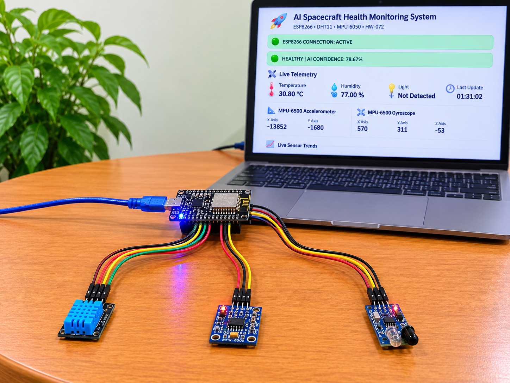

# 🛰️ AI-Based Spacecraft Health Monitoring System


An AI-powered spacecraft health monitoring prototype that combines an ESP8266 NodeMCU, real-time sensor telemetry, a Random Forest classifier, and a Streamlit dashboard.

The system classifies telemetry-based health conditions into three categories:

🟢 HEALTHY | 🟡 WARNING | 🔴 CRITICAL

⚠️ Note: This is an experimental, ground-based research prototype. It is trained on synthetic data and has not been validated on real spacecraft telemetry.

## 📸 Hardware Implementation


Hardware setup

ESP8266-based sensor interfacing and hardware testing.

### Components
Component	Function
ESP8266 NodeMCU	Main controller
DHT11	Temperature and humidity
MPU-6500	Accelerometer and gyroscope
HW-072	Light detection

### Wiring
Sensor	           Sensor Pin	       NodeMCU Pin
DHT11	               DATA	              D6
MPU-6500	           SDA	              D2
MPU-6500	           SCL	              D1
HW-072	             DO                 D3
Rest All	           VCC                3V3
                     Gnd                Gnd

                     
##📊 Live Monitoring Dashboard

Dashboard


The Streamlit dashboard displays:

ESP8266 connection status
Live sensor telemetry
AI health classification
Prediction confidence
Accelerometer and gyroscope readings
Real-time sensor trends

Sensor data visualization

🧠 Machine Learning
Algorithm: Random Forest Classifier
Dataset: 3,000 synthetic telemetry samples, generated using separate value ranges for each health class
Input Features
Feature	Source
Temperature	DHT11
Humidity	DHT11
Acceleration (ax, ay, az)	MPU-6500
Gyroscope (gx, gy, gz)	MPU-6500
Light intensity	HW-072
Dataset Distribution
Health Class	Samples
HEALTHY	1,000
WARNING	1,000
CRITICAL	1,000
Total	3,000
Model Performance
Metric	Value
Training samples	2,400
Testing samples	600
Train-test split	80:20
Test accuracy	100%


The 100% accuracy is expected because the synthetic classes were generated with well-separated feature ranges, which makes them easy to classify. It reflects performance on the synthetic test set only and does not represent performance on real spacecraft telemetry.


## ⚙️ System Architecture
DHT11 + MPU-6500 +HW-072
ESP8266 NodeMCU
Serial Communication
Python Processing
Random Forest Classifier
HEALTHY / WARNING /CRITICAL
Streamlit Dashboard


## 📁 Project Structure

```text
AI-SPACECRAFT-HEALTH-MONITOR/
│
├── data/                       # Synthetic telemetry dataset
│
├── models/                     # Trained machine learning models
│
├── images/                     # Project photographs and screenshots
│   ├── hardware-setup.png      # Actual hardware implementation
│   ├── dashboard.png           # Live monitoring dashboard
│   └── hardware-demo.png       # Additional hardware demonstration
│
├── app.py                      # Streamlit dashboard
├── generate_dataset.py         # Synthetic dataset generation
├── live_monitor.py              # Live sensor monitoring
├── serial_reader.py             # ESP8266 serial communication
├── train_model.py               # Random Forest model training
│
├── test_live_ai.py              # Live AI testing
├── test_model.py                # ML model testing
│
├── requirements.txt             # Python dependencies
├── .gitignore                   # Git ignore configuration
└── README.md                    # Project documentation
```

## 🚀 Getting Started

1. Clone the repository
bash
git clone https://github.com/D555hruv/AI-SPACECRAFT-HEALTH-MONITOR.git
cd AI-SPACECRAFT-HEALTH-MONITOR
2. Install dependencies
bash
pip install -r requirements.txt
3. Upload firmware to ESP8266
Open the firmware sketch in Arduino IDE.
Install the required libraries (DHT sensor library, MPU6500/MPU6050 library, etc.).
Select board NodeMCU 1.0 (ESP-12E Module) and the correct COM port.
Upload the sketch. Baud rate: TODO (e.g. 115200).
4. Run the dashboard

Set your COM port in the Python code (TODO: variable/file name), then run:

bash
streamlit run app.py

## 💻 Technologies Used

Python • Scikit-learn • Pandas • NumPy • Streamlit • Plotly • Joblib • ESP8266 • Embedded C/C++

## ⚠️ Limitations
Trained on synthetic data, not real spacecraft telemetry.
DHT11 and MPU-6500 are hobby-grade sensors, not space-qualified.
Ground-based prototype; no radiation, vacuum or thermal-cycling testing.
Reported accuracy applies to the synthetic test set only.

## 🚀 Future Scope
Advanced anomaly detection
Real-world telemetry dataset integration
Fault detection and diagnostics
Spacecraft digital twin development
Extended hardware testing


# 🔬 Research Publication

AI-Based Spacecraft Health Monitoring System: A Machine Learning Approach for Telemetry-Based Health Classification

Journal: Acceleron Aerospace Journal
Volume / Issue: 7, Issue 1 (2026)
Pages: 2007–2016
DOI: 10.61359/11.2106-2631

📄 Read the Published Research Paper

How to Cite
bibtex
@article{sinha2026spacecraft,
  author  = {Sinha, Dhruv},
  title   = {AI-Based Spacecraft Health Monitoring System: A Machine Learning Approach for Telemetry-Based Health Classification},
  journal = {Acceleron Aerospace Journal},
  volume  = {7},
  number  = {1},
  pages   = {2007--2016},
  year    = {2026},
  doi     = {10.61359/11.2106-2631}
}

[Link to the Reasearch paper](https://acceleron.org.in/index.php/aaj/article/view/379)

👨‍💻 Author

Dhruv Sinha B.Tech – Electrical and Electronics Engineering Gaya College of Engineering, Bihar, India

GitHub: D555hruv
LinkedIn: Dhruv Sinha
ORCID: 0009-0004-7097-2419

An experimental research prototype exploring AI-driven spacecraft health monitoring through embedded systems and telemetry analysis. 🛰️
