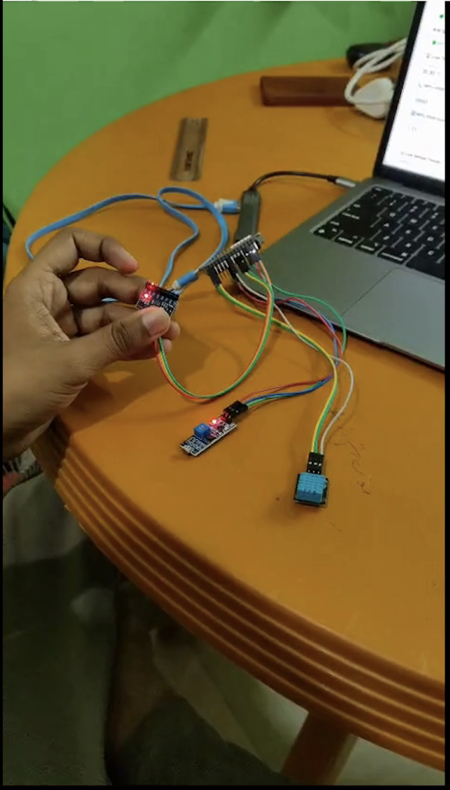
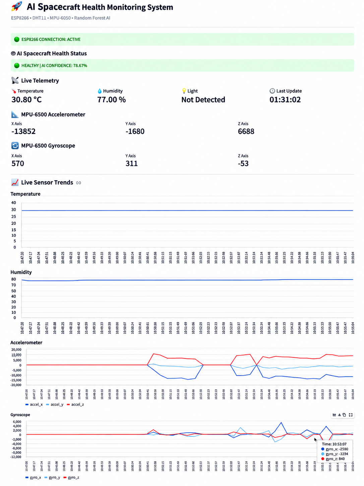
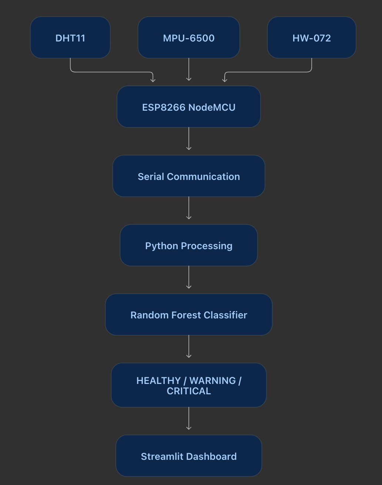

# 🛰️ AI-Based Spacecraft Health Monitoring System


An AI-powered spacecraft health monitoring prototype that combines an **ESP8266 NodeMCU**, multi-sensor telemetry acquisition, a **Random Forest** classifier, and a real-time **Streamlit** dashboard.

The system analyzes sensor telemetry and classifies the estimated system health into three categories:

- 🟢 **HEALTHY** – Normal operating conditions
- 🟡 **WARNING** – Potential abnormal operating conditions
- 🔴 **CRITICAL** – Critical conditions identified by the classifier

> **Research Note:** This is an experimental, ground-based research prototype. The model is trained on synthetic telemetry data and has not been validated on real spacecraft telemetry.

---

## 📑 Table of Contents

- [Hardware Implementation](#-hardware-implementation)
- [Live Monitoring Dashboard](#-live-monitoring-dashboard)
- [Machine Learning Model](#-machine-learning-model)
- [System Architecture](#️-system-architecture)
- [Project Structure](#-project-structure)
- [Getting Started](#-getting-started)
- [Technologies Used](#-technologies-used)
- [Limitations](#️-limitations)
- [Future Scope](#-future-scope)
- [Research Publication](#-research-publication)
- [Author](#-author)

---

## 📸 Hardware Implementation



*ESP8266-based sensor interfacing and hardware testing.*

### Hardware Components

| Component       | Function                                       |
| --------------- | ---------------------------------------------- |
| ESP8266 NodeMCU | Main microcontroller                           |
| DHT11           | Temperature and humidity sensing               |
| MPU-6500        | 3-axis accelerometer and gyroscope             |
| HW-072          | Light detection (digital output)               |

### Hardware Connections

| Sensor   | Sensor Pin | ESP8266 NodeMCU |
| -------- | ---------- | --------------- |
| DHT11    | DATA       | D6 (GPIO12)     |
| MPU-6500 | SDA        | D2 (GPIO4)      |
| MPU-6500 | SCL        | D1 (GPIO5)      |
| HW-072   | DO         | D3 (GPIO0)      |

### Power Connections

| Connection | NodeMCU |
| ---------- | ------- |
| Sensor VCC | 3V3     |
| Sensor GND | GND     |

> **Note:** Signal connections are based on the implemented hardware configuration. Verify each sensor's power connection before powering the circuit.
>
> **Boot tip:** D3 (GPIO0) is a boot-mode pin on the ESP8266. If the board fails to boot or upload, temporarily disconnect the HW-072 DO wire.

---

## 📊 Live Monitoring Dashboard



The Streamlit dashboard provides a graphical interface for monitoring sensor telemetry and displaying the model's predictions.

### Dashboard Features

- ESP8266 connection status
- Live sensor telemetry
- AI-based health classification
- Prediction confidence
- Accelerometer and gyroscope readings
- Real-time sensor trend visualization

---

## 🧠 Machine Learning Model

**Algorithm:** Random Forest Classifier

**Dataset:** 3,000 synthetic telemetry samples, generated using separate value ranges for each health class.

### Input Features

| Feature                   | Sensor Source |
| ------------------------- | ------------- |
| Temperature               | DHT11         |
| Humidity                  | DHT11         |
| Acceleration (ax, ay, az) | MPU-6500      |
| Gyroscope (gx, gy, gz)    | MPU-6500      |
| Light                     | HW-072        |

### Dataset Distribution

| Health Class | Samples   |
| ------------ | --------- |
| HEALTHY      | 1,000     |
| WARNING      | 1,000     |
| CRITICAL     | 1,000     |
| **Total**    | **3,000** |

### Model Training and Evaluation

| Metric           | Result |
| ---------------- | ------ |
| Training samples | 2,400  |
| Testing samples  | 600    |
| Train-test split | 80:20  |
| Test accuracy    | 100%   |

> **Important:** The 100% accuracy applies only to the synthetic test set. The synthetic classes were generated with well-separated feature ranges, which makes them easy to classify. This does **not** represent performance on real spacecraft telemetry.

---

## ⚙️ System Architecture



**Pipeline:** DHT11 + MPU-6500 + HW-072 → ESP8266 NodeMCU → Serial Communication → Python Processing → Random Forest Classifier → HEALTHY / WARNING / CRITICAL → Streamlit Dashboard

---

## 📁 Project Structure

```text
AI-SPACECRAFT-HEALTH-MONITOR/
│
├── firmware/
│   └── esp8266_sensor_monitor.ino   # ESP8266 sketch (rename to match yours)
│
├── data/
│   ├── telemetry.csv
│   └── training_dataset.csv
│
├── images/
│   ├── dashboard.png
│   ├── hardware-setup.png
│   ├── Spacecraft Health Dashboard.png
│   └── Architecture.png
│
├── models/
│   └── health_model.pkl
│
├── app.py                  # Streamlit dashboard
├── generate_dataset.py     # Synthetic dataset generation
├── train_model.py          # Random Forest training
├── live_monitor.py         # Live sensor monitoring
├── serial_reader.py        # ESP8266 serial communication
│
├── test_model.py           # Model testing
├── test_live_ai.py         # Live AI testing
│
├── requirements.txt
├── .gitignore
└── README.md
```

---

## 🚀 Getting Started

### 1. Clone the repository

```bash
git clone https://github.com/D555hruv/AI-SPACECRAFT-HEALTH-MONITOR.git
cd AI-SPACECRAFT-HEALTH-MONITOR
```

### 2. Install dependencies

```bash
pip install -r requirements.txt
```

### 3. Upload firmware to the ESP8266

1. Open the firmware sketch from the `firmware/` folder in Arduino IDE.
2. Install the required libraries (DHT sensor library, MPU6500/MPU6050 library).
3. Select board **NodeMCU 1.0 (ESP-12E Module)** and the correct COM port.
4. Connect the sensors as shown in [Hardware Connections](#hardware-connections).
5. Upload the sketch.

### 4. Run the dashboard

Set the correct serial port (e.g. `COM3` on Windows or `/dev/ttyUSB0` on Linux) in the Python code, and make sure the baud rate matches the `Serial.begin(...)` value in the sketch. Then run:

```bash
streamlit run app.py
```

Open the local Streamlit URL shown in the terminal to view the dashboard.

### Retrain the model (optional)

```bash
python generate_dataset.py
python train_model.py
```

---

## 💻 Technologies Used

| Area             | Tools                                   |
| ---------------- | --------------------------------------- |
| Programming      | Python, Embedded C/C++                  |
| Machine Learning | Scikit-learn, Random Forest             |
| Data Processing  | Pandas, NumPy                           |
| Visualization    | Streamlit, Plotly                       |
| Model Storage    | Joblib                                  |
| Hardware         | ESP8266 NodeMCU, DHT11, MPU-6500, HW-072 |

---

## ⚠️ Limitations

- Trained on synthetic data, not real spacecraft telemetry.
- DHT11 and MPU-6500 are hobby-grade sensors, not space-qualified.
- Ground-based prototype: no radiation, vacuum, or thermal-cycling testing.
- Reported accuracy applies to the synthetic test set only.
- Not a flight-ready spacecraft monitoring system.

---

## 🔭 Future Scope

- Advanced anomaly detection (Isolation Forest, Autoencoders)
- Integration of real-world telemetry datasets
- Fault detection and diagnostics
- Spacecraft digital twin development
- Extended hardware testing and validation

---

## 🔬 Research Publication

**Title:** AI-Based Spacecraft Health Monitoring System: A Machine Learning Approach for Telemetry-Based Health Classification

| Detail  | Information                 |
| ------- | --------------------------- |
| Journal | Acceleron Aerospace Journal |
| Volume  | 7                           |
| Issue   | 1                           |
| Year    | 2026                        |
| Pages   | 2007–2016                   |
| DOI     | 10.61359/11.2106-2631       |

📄 **Read the paper:** [https://acceleron.org.in/index.php/aaj/article/view/379](https://acceleron.org.in/index.php/aaj/article/view/379)

🔗 **DOI:** [https://doi.org/10.61359/11.2106-2631](https://doi.org/10.61359/11.2106-2631)

### How to Cite

```bibtex
@article{sinha2026spacecraft,
  author  = {Sinha, Dhruv},
  title   = {AI-Based Spacecraft Health Monitoring System:
             A Machine Learning Approach for Telemetry-Based
             Health Classification},
  journal = {Acceleron Aerospace Journal},
  volume  = {7},
  number  = {1},
  pages   = {2007--2016},
  year    = {2026},
  doi     = {10.61359/11.2106-2631}
}
```

---

## 📜 License


This project is licensed under the MIT License.
See the [LICENSE](LICENSE) file for details.

---

## 👨‍💻 Author

**Dhruv Sinha**
B.Tech – Electrical and Electronics Engineering
Gaya College of Engineering, Bihar, India

- **GitHub:** [D555hruv](https://github.com/D555hruv)
- **LinkedIn:** [Dhruv Sinha](https://www.linkedin.com/in/dhruv-sinha-btech2027/)
- **ORCID:** [0009-0004-7097-2419](https://orcid.org/0009-0004-7097-2419)

---

*An experimental research project exploring AI-driven spacecraft health monitoring through embedded systems, sensor telemetry, and machine learning-based health classification.* 🛰️
